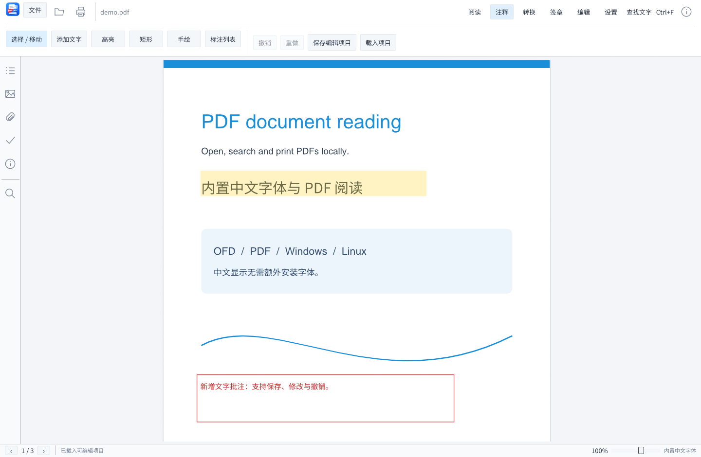

# 简阅 0.3.0

Rust 编写的 **OFD / PDF 文档阅读器**，面向 Windows、Linux，以及 x86 32 位、x86-64、ARM64。运行时本地解析，不需要 Java、浏览器内核、外部 PDF 软件或联网。



## 下载

正式下载请使用 [GitHub Release](https://github.com/lapin2024/jian-yue/releases/tag/v0.3.0)，按操作系统和 CPU 架构选择发布包。Windows 解压后运行 简阅.exe，Linux 运行 jian-yue。校验清单在 Release 的 SHA256SUMS.txt。

## 功能

- **阅读**：OFD 与 PDF 双格式，连续下拉或单页翻页，缩放、适应宽度/页面/高度、90° 旋转，大纲、缩略图、附件与文档信息面板，全文搜索。
- **中文字体**：内置 Noto Sans SC，未嵌入字体的 PDF 也能正常显示中文。
- **注释**：文字批注、矩形、高亮和手绘，可选中、移动与删除。
- **编辑**：修改新增文字及位置尺寸，页面前后移动、删除和永久旋转，支持撤销/重做，编辑项目可保存与恢复。
- **转换**：OFD 与 PDF 外观互转，可指定页范围和 96 / 150 / 300 DPI，页面可导出为 PNG 或 PNG ZIP。
- **签章**：印章图片贴入页面；P12/PFX RSA 证书对 PDF 做 CMS 数字签名；生成并验证独立 .p7s 完整性签名。
- **打印**：支持页范围、份数、DPI，可直达系统打印机，也可另存打印用 PDF。
- **系统集成**：可注册 .ofd / .pdf 默认打开程序，支持拖入文件打开。


## 使用

Windows 解压对应架构发布包，运行 简阅.exe；Linux 解压后运行 ./jian-yue。包中 samples/demo.ofd 和 samples/demo.pdf 分别是三页原创示例。

| 操作 | 方法 |
|---|---|
| 打开 OFD/PDF | 顶部文件菜单、文件夹图标、Ctrl+O，或拖入文件 |
| 连续阅读 | 默认启用，鼠标滚轮向下浏览；“连续阅读 / 单页”切换 |
| 翻页与跳页 | 首页/上一页/页码框/下一页/尾页；PageUp、PageDown |
| 缩放 | 显示比例、缩小/放大、Ctrl+滚轮、底部滑块 |
| 适应显示 | 实际大小、适合宽度、适合页面、适合高度 |
| 旋转 | 顺时针或逆时针，每次 90° |
| 搜索 | Ctrl+F 或查找按钮，点击结果跳转 |
| 导航与详情 | 左侧图标打开大纲、缩略图、附件、检查和信息面板 |
| 打印 | Ctrl+P 或打印按钮 |
| 导出 | 文件菜单中的 PNG、全文文字、检查报告；附件面板另存 |
| 全屏 | 工具栏按钮或 F11，Esc 退出 |

多文档 OFD 包可在“文档信息”面板切换包内文档。OFD-A 显示只读提示。程序只修改工作副本，所有导出路径都检查是否与原件冲突。

扫描型 OFD/PDF 没有 OCR 文字层时，搜索无法查到图像中的文字。当前 PDF 支持文字和大纲读取；交互表单、PDF 附件尚未实现，签名需在签章工具页主动验证。

## 打印说明

1. 点击“打印”或按 Ctrl+P。
2. 页面范围留空代表全部；可输入 1-3,5。设置份数 1–99 和 96 / 150 / 300 DPI。
3. Windows 点击“下一步：系统打印”，在系统窗口选择打印机、纸张并最终确认。Linux 选择已配置的 CUPS 打印机并点击确认打印。
4. “保存打印 PDF”只生成文件，不会向打印机提交。保存文件包含所选页面一次，份数仅用于实体打印队列。

打印使用阅读器的渲染结果栅格化输出，默认 150 DPI，自动适合打印机可打印区域。它不会保留矢量字体、表单或数字签名。超大页面会降低分辨率以控制内存。存在渲染提示或错误的文档会阻止打印，避免输出缺失内容。Windows 提交前预检全部所选页面。

Linux 需要安装 cups-client，配置打印队列，并能执行 lp 和 lpstat。保存打印 PDF 不依赖 CUPS。Windows 可选择系统中的“Microsoft Print to PDF”等打印机，但生成文件仍需在系统窗口中确认。

示例编辑项目：打开 samples/demo.pdf，再载入 samples/demo.reader.json，可以看到高亮、矩形和新增中文文字。

## 注释与编辑

打开普通 OFD 或 PDF 后，选择顶部“注释”或“编辑”：

1. **文字**：在工具栏输入文字，点击页面放置。选中文字后在“标注列表”修改内容、字号、X/Y 和宽高。
2. **高亮 / 矩形 / 手绘**：选择工具后在页面上拖动，松开鼠标完成。颜色和线宽可调整。
3. **选择 / 移动**：点击新增标注，再拖动移动。标注列表或 Delete 可删除。
4. **页面调整**：在标注与页面管理窗口移动页面、删除页面或永久旋转。工具栏的阅读旋转只改变视图。
5. **撤销 / 重做**：按钮或 Ctrl+Z / Ctrl+Y。
6. **保存编辑项目**：Ctrl+S 保存 .reader.json，保留可修改的标注、印章和页面顺序。恢复时先打开原文件，再载入项目。
7. **保存文档副本**：进入转换窗口保存 PDF/OFD，把工作副本的页面外观输出到新文件。

编辑项目按 SHA-256 绑定原件，需与原文档一同保存。项目不会写入密码或私钥。打开其他文件时，尚未保存的项目会提示。

**编辑范围是新增文字、图形、印章和页面调整；当前不能直接修改或重排原文段落，也没有真正的敏感信息擦除工具。** 项目中的高亮是矩形区域，不是逐字选中。注释不写成其他阅读器可继续编辑的原生批注结构；需要继续修改时保留项目。

OFD-A 保持只读，不允许增加标注、印章或调整页面。原件中的数字签名不会随编辑副本保留。

## 转换

顶部“转换”支持 PDF、OFD、PNG ZIP。输入输出页面范围，选择 DPI，再另存。

当前是**页面外观转换**：文字、图像、矢量、当前编辑一起栅格化，保留页面大小和所选页面顺序；不保留可搜索文字层、附件、表单、大纲或签名结构。保存编辑副本也采用此方式。复杂/缺失内容导致的渲染提示会阻止转换。

## 可见印章与证书签名

可见印章：进入“签章”导入 PNG/JPG 图片，点击页面放置；在标注列表调整尺寸/位置。透明 PNG 最适合印章。图片只是视觉外观，不是验签结果。

证书签名：

- **PDF 内嵌签名**：使用自己的 P12/PFX（含一个 RSA 私钥和证书），输入密码，另存 signed.pdf。格式为 RSA/SHA-256 + CMS，adbe.pkcs7.detached。程序拒绝重写已有数字签名的 PDF，不支持增量多重签名。
- **OFD/PDF 分离签名**：生成 .p7s，覆盖原文件的完整字节。它是通用 CMS 文件签名，**不是 GB/T 38540 / SM2 国密 OFD 电子签章**。
- **先编辑后签名**：先把带印章/标注的工作副本保存为新文档，再打开新文档签名；不能把原件签名声称为未保存工作副本的签名。
- **验签**：选“验证 PDF 签名”，或选择对应 .p7s 验证当前原文件。结果显示摘要匹配、证书指纹、当前有效期和文件覆盖情况。若签名后有追加数据，file_fully_covered 为 false。

当前支持 RSA 2048–8192 位；暂不支持 SM2、ECDSA、UKey 或硬件证书。证书密码不保存到项目，签名器不另存私钥。

**验签只核对密码学完整性；不验证 CA 信任链、吊销状态和可信时间戳。** “摘要匹配”不能当作可信身份认证。tests/fixtures 中的测试证书仅供回归测试，不用于真实签章。

## 设置默认打开程序

将发布包解压到稳定目录，进入“设置”，勾选 .ofd / .pdf 并点击“设置默认打开程序”。移动程序或更换目录后，请在新位置再次设置。

若双击提示 Windows 无法访问指定设备、路径或文件，请直接运行解压目录中的“简阅.exe”，在“设置”中重新注册默认打开程序，并在系统设置中确认选择。

- Windows 注册到当前用户，然后打开默认应用设置，由您把相应扩展名选择为简阅。Windows 的 UserChoice 不由本程序强行改写。
- Linux 在当前用户目录安装桌面启动项和图标，并通过 xdg-mime 设置。需要 xdg-utils 和 shared-mime-info；程序移动位置后请重新设置。

## 命令行

```powershell
.\简阅.exe document.pdf
.\简阅.exe --inspect document.pdf --output report.json
.\简阅.exe --render document.pdf --page 2 --zoom 1.5 --rotate 90 --output page.png
.\简阅.exe --text document.pdf --output text.txt
.\简阅.exe --print-pdf document.ofd --pages 1-3 --dpi 150 --output print.pdf
.\简阅.exe --extract-attachment document.ofd --attachment 1 --output attachment.txt
.\简阅.exe --inspect document.ofd --document 2
.\简阅.exe --convert document.pdf --pages 1-3 --dpi 150 --output document.ofd
.\简阅.exe --render document.pdf --project document.reader.json --output edited.png
.\简阅.exe --verify-signature signed.pdf
.\简阅.exe --verify-signature document.ofd --signature document.p7s
```

Linux 将命令前缀换为 ./jian-yue。页码和文档序号从 1 开始。命令行没有自动向打印机提交的入口；--print-pdf 只生成文件。

## 格式与标准范围

OFD 部分参考用户提供的 GB/T 42133—2022《信息技术 OFD 档案应用指南》，以及其引用的 GB/T 33190—2016。已实现页面、资源、字体、路径、常见图像、常见轴向及圆形径向渐变、基础复合对象、静态注释外观、大纲、附件和部分档案静态检查。

本程序**不是完整国标实现，也未通过合规认证**。PDF 不适用 OFD 档案标准检查；PDF 检查面板只显示阅读兼容性提示。

PDF 使用 Hayro 0.4.0 进行本地软件渲染，lopdf 解析元数据/文字/大纲。内置 PDF 标准字体；常见 UniGB-UCS2-H / UniGB-UTF16-H 未嵌入中文字体在内存中的阅读副本替换为内置 Noto Sans SC。未知 CMap、复杂字形或未支持字体仍会提示，替代字形可能与原字体不同。原 PDF 字节不回写。

暂不支持密码保护/加密 PDF、PDF JavaScript 和交互操作；数字签名不会自动认证；可在签章工具页验证所支持的 RSA/SHA-256 签名。OFD 支持常见轴向渐变和起始半径为零的圆形径向渐变；非零起始半径、椭圆径向渐变及径向 MapUnit 会提示并使用首段颜色。JBIG2/JPEG2000、网格渐变、图案填充、复杂字形映射和专用签章外观仍有限制。详见 [标准对照与兼容范围](docs/standard-coverage.md)。

## 从源码构建

Rust 1.90.0，依赖由 Cargo.lock 固定。

```powershell
.\scripts\build.ps1 -Task test
.\scripts\build.ps1 -Task release
```

```sh
# Debian / Ubuntu 原生构建
sudo apt-get install build-essential pkg-config libx11-dev libxkbcommon-dev \
  libwayland-dev libegl1-mesa-dev libgl1-mesa-dev cups-client
sh scripts/build.sh test
sh scripts/build.sh release
# 无图形界面的纯 CLI 构建
cargo build --release --locked --no-default-features
```

各平台目标与交叉构建见 [开发说明](docs/development.md)。

限制：OFD 解压总量 256 MiB、单条目 32 MiB、XML 8 MiB、8192 ZIP 条目、2000 页、200000 图元、32 层嵌套；PDF 输入最多 128 MiB、2000 页；单次页面输出最多 1600 万像素。

## 许可

代码 MIT；内置 Noto Sans SC 采用 SIL OFL 1.1，随包保留许可证。源字体固定为 wght=400，未删除字形。示例中的 Ubuntu 字体另附 UFL。发布包附带第三方许可清单和许可文本，见 [第三方声明](docs/third-party-notices.md)。
