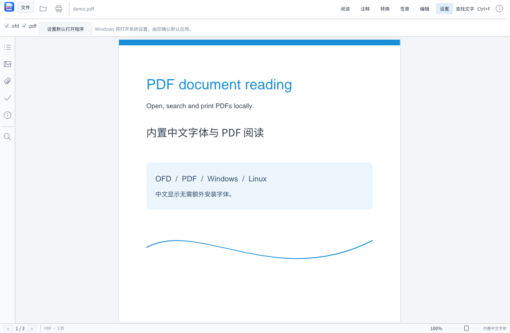

# 简阅 0.3.0 构建与验证记录

日期：2026-10-10（Asia/Shanghai）。本记录针对最终包含注释、编辑、转换、签名、图标、默认程序入口、滚动优化和拖入修复的版本。

## 平台产物

| 平台 | 文件架构 | 编译 | 运行验收 |
|---|---|---|---|
| Windows x86-64 | PE AMD64 | 成功 | 32 项 CLI、工具页与 OFD 界面截图 |
| Windows x86 32 位 | PE I386 | 成功 | 32 项 CLI、签章工具页截图；当前 x64 Windows 上运行 |
| Windows ARM64 | PE ARM64 | 成功 | 尚未 ARM64 真机运行 |
| Linux x86-64 | ELF64 X86-64 | 成功 | 尚未 Linux 运行 |
| Linux x86 32 位 | ELF32 I386 | 成功 | 尚未 Linux 运行 |
| Linux ARM64 | ELF64 AARCH64 | 成功 | 尚未 ARM64 Linux 真机运行 |

Windows 包的程序名为 简阅.exe，Linux 为 jian-yue。窗口、版本资源、默认应用名称和说明均统一为简阅；Rust 库内部继续叫 ofd_reader。

三个 Linux 文件 ELF 符号版本的最高 GLIBC 要求均为 2.28。窗口/驱动/桌面门户和默认关联仍需相应发行版验证。Windows ARM64 包附带匹配架构的 libunwind.dll。

## 最终代码检查

- cargo fmt --all -- --check：通过。
- cargo clippy --offline --all-targets -- -D warnings：通过，无警告。
- cargo test --offline：**68 项通过**，其中 40 项原有核心测试、17 项编辑/转换/签名/关联/图标测试、11 项界面与输入测试。

新增测试包含：透明高亮、中文文字、矩形鼠标拖动、手绘/印章、页面顺序/删除/旋转、项目保存与 SHA-256 绑定、撤销/重做、OFD-A 禁止编辑、格式互转重新打开、PNG ZIP、错误密码、分离签名篡改拒绝、PDF 内嵌签名和追加数据覆盖检查、默认关联计划的路径引用以及 ICO 尺寸。

## 拖入打开修复

原生拖放显式开启，DroppedFile 队列处理时取走并消费，避免重复打开。先筛选有效本地 OFD/PDF，不静默打开批次的第一项或目录；多文档提供选择窗口；不支持项显示说明，保留当前文档。

在真实 egui RawInput 中注入 DroppedFile，四项回归全部通过：

1. 中文、空格、大写 .PDF 路径被接收并只触发一次打开；调用文档加载器确认可解析。
2. 文件夹混合大写 .OFD 拖入时正确选择文档，确认三页可解析。
3. 非文档拖入不会关闭当前文档，显示错误提示。
4. 多份文档进入选择状态，而不是静默选择错误文件。

本次未通过资源管理器人工拖放进行 OS 层验收；测试覆盖输入消费、选择和加载逻辑。虚拟邮件/浏览器附件没有本地路径时要求先另存。

## 滚动优化

只绘制视口及附近页面，二分定位累计页位置；快速滚动时先请求预览，停稳 160 ms 后补高清；跳过离屏过期任务，每帧最多上传一个新纹理；高分辨率页面缓存维持 64 MiB 上限。

真实 egui MouseWheel 测试验证了跨页、页码跟随、连续/单页跳转、快速滚动延期高清请求、缓存上限。

500 页无窗口布局测试的本机样本：中位数 0.119 ms / 帧，P95 0.191 ms / 帧。该数字**排除文档栅格化、GPU 上传和系统窗口合成**，不是整体 FPS 或所有硬件流畅性的承诺。

## Windows 发布版 CLI

x64/x86 各 **32 项通过**，设置 OFD_READER_NO_SYSTEM_FONTS=1，验证不依赖系统中文字体。

包含 OFD/PDF 读取、文字、PNG、旋转、附件、打印文件、异常参数、保护原件、PDF/OFD/PNG 转换、编辑项目的文字和外观导出、证书签名、PDF 验签、OFD .p7s、不同文件验签拒绝、已有签名重写拒绝。

原 OFD/PDF 的 SHA-256 在操作前后保持不变。测试签名只用 tests/fixtures 的公开测试身份，未使用个人证书。

记录位于 verification/windows-*-cli-checks.json。

## 签名独立复核

除了 Rust 自检，还从最终 signed.pdf 的 AcroForm 与 ByteRange 提取真实签名数据，并使用独立 OpenSSL CMS 验证器校验：

- PDF 内嵌 RSA/SHA-256 签名：CMS Verification successful。
- OFD 完整包 .p7s：CMS Verification successful。
- 验证器输出的已签字节逐字节等于原覆盖内容。

验证使用 -noverify，**未验证证书信任链**。它证明 CMS 完整性互操作，不是 CA 身份认证。签章界面也明确区分图片外观、PDF 证书签名和 OFD 通用分离签名；未实现国密标准 OFD 电子签章、硬件证书、CRL/OCSP 或可信时间戳。

独立验证结果位于 verification/independent-cms.json。

## 图标与名称

核对三种 Windows PE：均嵌入六个图标尺寸 32、48、64、96、128、256。资源中 PNG 字节与用户原图相同，未重画或缩放。512 PNG 保留给 Linux。程序版本资源中的“简阅”按 UTF-16 检查通过。

ARM64 图标使用 llvm-rc + llvm-cvtres 显式生成 ARM64 COFF，解决 windres 架构别名兼容问题。

结果位于 verification/icon-resources.json。

## 界面和验证边界

最终 Windows 程序已实际启动并截图检查注释、签章、设置和 OFD 阅读工具区，内置中文字体和用户图标均正常显示。

默认关联的测试只检查注册计划和路径处理，**没有修改本机 UserChoice、默认应用或真实注册表项**。Linux 关联安装代码已编译，尚未在桌面环境执行。打印文件生成和重新读取已验证，没有向实体打印机提交任务。

转换/保存是栅格化外观重建，不保留原文本层、附件、表单和签名结构。编辑限于新增内容和页面计划，不是原段落重排。项目可继续编辑，输出文档的标注被固化。

六种产物的机器类型、尺寸、SHA-256 和运行标记在 verification/artifacts.json；压缩包哈希在发布根目录 SHA256SUMS.txt。
